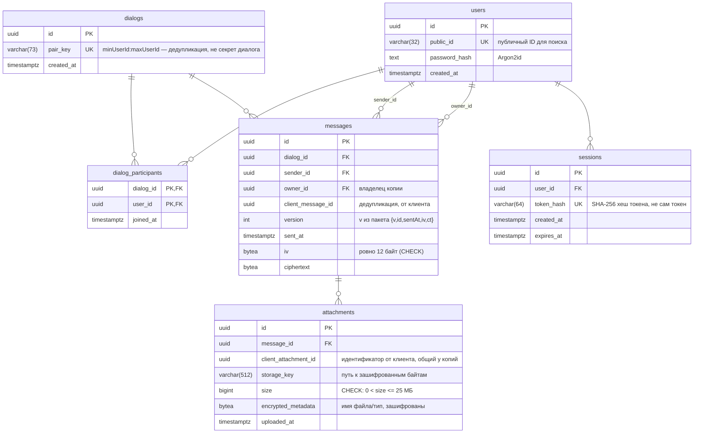

# Схема базы данных

СУБД: PostgreSQL 17. Доступ через EF Core / Npgsql, миграции — `dotnet ef`.
Именование таблиц и колонок — snake_case.

## ER-диаграмма



## Две копии сообщения

Одна строка `messages` = **одна копия, принадлежащая участнику** (`owner_id`).
При отправке в диалоге 1-на-1 создаются две строки с одинаковыми
`client_message_id / iv / ciphertext` (ключ диалога общий) и разными `owner_id`:

- «удалить у себя» — физический `DELETE` строки владельца, копия второго остаётся;
- «удалить у обоих» — `DELETE` обеих строк в одной транзакции.

## Сессии

Токен сессии — 32 случайных байта в base64url, клиенту уходит в HttpOnly-cookie.
В БД хранится **только SHA-256 хеш токена**, поэтому утечка базы не даёт готовых сессий.
Выход удаляет строку сессии, поэтому защищённые запросы сразу возвращают 401.
Протухшие сессии удаляются при создании новой.

## Ограничения и индексы

| Объект                                                    | Назначение                                         |
|-----------------------------------------------------------|----------------------------------------------------|
| `users.public_id` UNIQUE                                  | поиск по точному публичному ID                     |
| `sessions.token_hash` UNIQUE                              | поиск сессии по хешу токена из cookie              |
| `dialogs.pair_key` UNIQUE                                 | дубликат диалога 1-на-1 не создаётся               |
| `messages(dialog_id, owner_id, client_message_id)` UNIQUE | идемпотентная отправка, дедупликация               |
| `messages(dialog_id, owner_id, sent_at)`                  | постраничная загрузка истории                      |
| `ck_messages_iv_length`: `length(iv) = 12`                | IV AES-256-GCM 96 бит                              |
| `ck_attachments_size`: `0 < size <= 25000000`             | лимит 25 МБ на вложение                            |
| `ck_attachments_client_id`                                | идентификатор вложения не может быть пустым        |
| `attachments(message_id, client_attachment_id)` UNIQUE    | клиентский идентификатор вложения уникален в копии |
| `attachments.message_id` ON DELETE CASCADE                | вложения уходят вместе с копией                    |
| `messages.sender_id/owner_id` ON DELETE RESTRICT          | удаление юзера не сносит историю молча             |

## Что храним / что не храним

| Хранилище | Содержимое | Не допускается |
|---|---|---|
| `users` | ID, публичный ID, Argon2id-хеш, дата создания | пароль открыто, телефон/email |
| `dialogs` | участники и дата создания | ключ диалога |
| `messages` | владелец копии, диалог, отправитель, v/id/sentAt/iv/ct | открытый текст |
| `attachments` | путь к зашифрованным байтам, размер, ссылки | открытые файлы, исходное имя файла |

## Хранилище файлов вложений

Зашифрованные байты лежат в управляемом файловом хранилище, каталог задаётся
настройкой `AttachmentStorage:RootPath` (по умолчанию `storage/attachments`).
Имя файла генерирует сервер: имя, присланное клиентом, не используется и
не сохраняется. В БД лежит только ключ файла (`attachments.storage_key`),
размер и зашифрованные клиентом метаданные.

В Docker Compose каталог подключён как том `api-storage` (`/app/storage`),
поэтому байты не пропадают при пересоздании контейнера.

## Команды

```bash
dotnet tool restore                  # dotnet-ef (локальный tool)
docker compose up -d postgres        # пустая БД
dotnet dotnet-ef database update \
  --project src/Messenger.Infrastructure \
  --startup-project src/Messenger.Api
```
